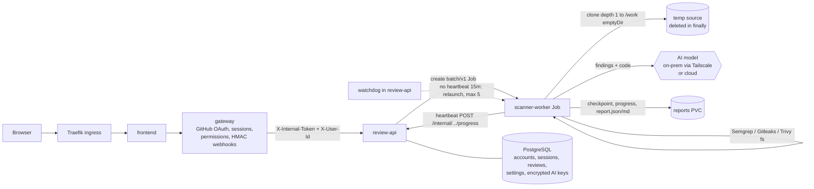

# AI Scan Repos

Review any public GitHub repository with security scanners (Semgrep, Gitleaks, Trivy) plus an AI reviewer,
running on Kubernetes (K3s). DevSecOps final project — lives alongside the earlier `devsecops-shop-*` project
and does not share code with it.

## Architecture



Review flow: `queued → running ⇄ paused → completed | failed`.

## Phase plan

| Phase | Scope | Status |
|---|---|---|
| 1 | Backend: review-api, scanner-worker, DB + migrations, tests, Dockerfiles, compose | ✅ this folder |
| 2 | Gateway (GitHub OAuth, sessions, HMAC webhooks) + React frontend | next |
| 3 | Helm charts / K3s manifests (namespaces, Traefik, Postgres StatefulSet 5Gi, reports PVC 5Gi noexec, RBAC for Jobs) | |
| 4 | Jenkins CI (Test → Build → Trivy → Push → bump tag in deployment repo), smee.io webhooks | |
| 5 | Argo CD GitOps on deployment repos | |
| 6 | Monitoring: kube-prometheus-stack, dashboards, alerts | |
| 7 | Installer image (web wizard) + Terraform EKS (VPC, EKS, EFS, ECR) | |

## Components (Phase 1)

### review-api (`review-api/`, FastAPI, port 8000)
Not exposed publicly — only the gateway (Phase 2) and scanner Jobs call it.

All `/reviews*` and `/ai-keys` routes require `X-Internal-Token: $INTERNAL_API_TOKEN` (constant-time compare) **and**
`X-User-Id: <gateway user id>`. The user id is trusted only because the token proves the caller is the gateway.

| Method | Path | Notes |
|---|---|---|
| POST | `/reviews` | `{repo_url, depth: quick\|brief\|deep, ai_provider?}` → 201 review. URL must be `https://github.com/<owner>/<repo>` |
| GET | `/reviews` | caller's reviews (newest first) |
| GET | `/reviews/{id}` | status, progress %, attempts, job_name, message |
| POST | `/reviews/{id}/pause` | writes `PAUSE` flag file; worker checkpoints and exits (409 if not running) |
| POST | `/reviews/{id}/resume` | removes flag, attempts+1, launches a new Job that resumes from checkpoint |
| GET | `/reviews/{id}/report`, `/report.md` | 404 until completed |
| PUT/GET | `/ai-keys` | store provider key (Fernet-encrypted); GET never returns key material |
| GET | `/internal/reviews/{id}` | worker reads repo_url/depth (token only) |
| POST | `/internal/reviews/{id}/progress` | worker heartbeat `{progress, status?, message?, report_path?, ai_provider?}` (token only) |
| GET | `/healthz`, `/readyz`, `/metrics` | probes + Prometheus |

Job launchers (`JOB_LAUNCHER`): `kubernetes` — in-cluster config, creates a hardened `batch/v1` Job
(non-root 10001, readOnlyRootFilesystem, drop ALL, seccomp RuntimeDefault, no SA token, emptyDir `/work`,
reports PVC at `/reports`, secrets only via `envFrom` Secret, `backoffLimit: 0`); `local` — subprocess for dev.

Watchdog: every `WATCHDOG_INTERVAL_SECONDS`, a running review with no heartbeat for
`HEARTBEAT_TIMEOUT_SECONDS` (900) gets a new Job (attempts+1); at `MAX_ATTEMPTS` (5) it is marked `failed`.

### scanner-worker (`scanner-worker/`)
`python -m scanner.run --review-id X` (DB-less; talks to review-api over internal HTTP).

1. Fetch review → shallow clone into `/work/src-*` → **always deleted in `finally`**.
2. Semgrep / Gitleaks (`--redact`) / Trivy fs with timeouts; a missing binary is recorded as `skipped`.
3. Depth: **quick** = scanners + short AI summary; **brief** = AI on top findings with code context;
   **deep** = AI per file (bounded by `DEEP_MAX_FILES`, `DEEP_MAX_FILE_BYTES`) + summary.
4. Checkpoint after every scanner and every file → `<REPORTS_DIR>/<id>/checkpoint.json` + `progress.json`
   (atomic tmp+rename). A rerun skips finished steps. `PAUSE` file → save and exit cleanly.
5. Writes `report.json` + `report.md` (summary, severity counts, per-scanner tables, AI recommendations).
   The report records the AI provider and `code_left_network` (true for cloud providers) with a clear warning.

AI providers (plain httpx): `openai_compatible` (LM Studio / Ollama / vLLM, needs `AI_BASE_URL`), `openai`,
`anthropic`, `gemini`, `grok` (xAI, OpenAI-compatible), or `none`.

## Run Phase 1 locally

### Docker Compose
```bash
cd ai-scan-repos
cp .env.example .env            # set INTERNAL_API_TOKEN and AI_KEYS_ENCRYPTION_KEY
docker compose up --build
H='-H X-Internal-Token:change-me-long-random -H X-User-Id:me'
curl -s -XPOST localhost:8000/reviews $H -H 'content-type: application/json' \
  -d '{"repo_url":"https://github.com/octocat/Hello-World","depth":"quick"}'
curl -s localhost:8000/reviews $H
curl -s localhost:8000/reviews/<id>/report.md $H
```
Compose uses `review-api/Dockerfile.local` (API + worker + scanners in one dev container, `JOB_LAUNCHER=local`).
Production uses the two separate images below with `JOB_LAUNCHER=kubernetes`.

### Without Docker (tests)
```bash
cd ai-scan-repos/review-api     && python -m venv .venv && . .venv/bin/activate && pip install -r requirements-dev.txt && pytest --cov=app
cd ai-scan-repos/scanner-worker && python -m venv .venv && . .venv/bin/activate && pip install -r requirements-dev.txt && pytest --cov=scanner
```

### Images
```bash
docker build -t ai-scan-repos/review-api:dev     ai-scan-repos/review-api
docker build -t ai-scan-repos/scanner-worker:dev ai-scan-repos/scanner-worker
```
Both run as UID 10001; no repository source is baked into the scanner image.

## Environment variables

| Var | Service | Default | Notes |
|---|---|---|---|
| `DATABASE_URL` | api | sqlite file | `postgresql+psycopg://…` in compose/K8s |
| `INTERNAL_API_TOKEN` | api, worker | dev placeholder | **Secret**; shared by gateway, api, worker |
| `AI_KEYS_ENCRYPTION_KEY` | api | — | **Secret**; Fernet key |
| `JOB_LAUNCHER` | api | `local` | `local` \| `kubernetes` |
| `REPORTS_DIR` | api, worker | `./reports` / `/reports` | reports PVC mount |
| `K8S_NAMESPACE`, `SCANNER_IMAGE`, `REPORTS_PVC`, `SCANNER_SERVICE_ACCOUNT`, `SCANNER_SECRET_NAME`, `REVIEW_API_INTERNAL_URL` | api | `ai-scan-repos`, …, `ai-scan-reports`, `scanner-worker`, `scanner-worker-env`, `http://review-api:8000` | Job template |
| `HEARTBEAT_TIMEOUT_SECONDS`, `MAX_ATTEMPTS`, `WATCHDOG_INTERVAL_SECONDS`, `WATCHDOG_ENABLED` | api | 900, 5, 60, true | recovery |
| `LOCAL_WORKER_CMD`, `LOCAL_WORKER_CWD` | api | `python -m scanner.run` | local launcher |
| `REVIEW_API_URL`, `WORK_DIR` | worker | `http://review-api:8000`, `/work` | |
| `AI_PROVIDER`, `AI_MODEL`, `AI_BASE_URL`, `AI_API_KEY` | worker | `openai_compatible` | **AI_API_KEY is a Secret** |
| `SCANNER_TIMEOUT_SECONDS`, `CLONE_TIMEOUT_SECONDS`, `DEEP_MAX_FILES`, `DEEP_MAX_FILE_BYTES`, `BRIEF_TOP_FINDINGS` | worker | 900, 300, 40, 60000, 10 | |

Secrets are never committed: in Kubernetes create them from the CLI, e.g.
`kubectl -n ai-scan-repos create secret generic scanner-worker-env --from-literal=INTERNAL_API_TOKEN=… --from-literal=AI_API_KEY=…`.

## Notes for next phases
- Gateway must inject `X-Internal-Token` and `X-User-Id` and strip any client-supplied copies.
- K8s (Phase 3): review-api ServiceAccount needs RBAC `create/get/list` on `batch/jobs` in `ai-scan-repos`;
  reports PVC must be RWX (or co-located) since both review-api and Jobs mount it; mount it `noexec`.
- Per-user AI keys are stored encrypted; Phase 2/3 will pass the selected key to the Job via a per-review Secret
  (Phase 1 worker reads `AI_API_KEY` from its env Secret).
