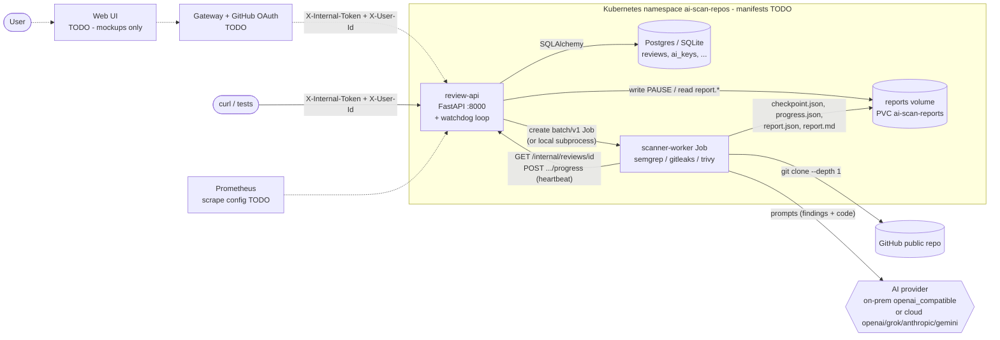

# Architecture — AI Scan Repos (as implemented, Phase 1)

## Component & data-flow diagram

Solid = implemented. Dashed = planned / not in repo (TODO).

## Review lifecycle

1. `POST /reviews` validates the URL (`https://github.com/<owner>/<repo>` only), stores a `Review`
   with `status=running, attempts=1`, and calls the launcher.
2. Launcher (`JOB_LAUNCHER`):
   - `local` – `subprocess.Popen("python -m scanner.run --review-id X")` (dev/tests).
   - `kubernetes` – in-cluster `BatchV1Api.create_namespaced_job`; Job `scan-<id>-a<attempt>-<rand>`,
     `backoffLimit: 0`, `ttlSecondsAfterFinished: 3600`, non-root UID 10001, read-only rootfs,
     drop ALL caps, no SA token, `emptyDir` `/work` (2Gi) and `/tmp`, PVC `/reports`, secrets via
     `envFrom` Secret `scanner-worker-env`. Requests 250m/512Mi, limits 2 CPU/2Gi.
3. Worker fetches the review via `/internal/reviews/{id}`, loads `checkpoint.json` if present, clones
   into `/work`, runs semgrep → gitleaks → trivy (each a checkpoint step), the AI phase, then writes
   the report and posts `status=completed`. The cloned source is always deleted (`finally`).
4. Each step calls `_beat()` → updates checkpoint/progress files + `POST .../progress` (heartbeat) and
   checks for the `PAUSE` file.
5. **Pause**: API writes `<reports>/<id>/PAUSE`; worker checkpoints and exits. **Resume**: API deletes
   the file, `attempts += 1`, launches a new job which resumes from the checkpoint.
6. **Watchdog** (in review-api, every 60 s): any `running` review with no heartbeat for 900 s is
   relaunched (`attempts += 1`) or marked `failed` once `attempts >= MAX_ATTEMPTS` (5). K8s retries are
   disabled so the watchdog owns retries.

Statuses: `queued` (defined, currently unused), `running`, `paused`, `completed`, `failed`.

## Data

`review-api` tables (Alembic `0001_initial`): `reviews`, `ai_keys` (Fernet-encrypted), and
`github_accounts`, `sessions`, `settings` (schema only — not used by any endpoint yet).

Report files per review on the reports volume: `checkpoint.json`, `progress.json`, `report.json`,
`report.md`, transient `PAUSE`. Findings are normalized to
`{scanner, rule, severity, file, line, message}`; severities mapped to CRITICAL…UNKNOWN. Gitleaks runs
with `--redact` and secret values are never stored.

## Security design (as coded)
- review-api is internal-only; `X-Internal-Token` compared with `hmac.compare_digest`.
- Only GitHub HTTPS URLs accepted; `git clone` uses `--` and `GIT_TERMINAL_PROMPT=0`.
- Secrets never in Job args — only via Secret `envFrom`.
- Hardened pod/container securityContext (see above); scanner image bakes no source code.
- Report records `ai.is_cloud` / `code_left_network` and the Markdown warns when code left the network.

## Observability
`/metrics`: `ai_scan_reviews_created_total{depth}`, `_retried_total`, `_failed_total`,
`_completed_total`, gauge `ai_scan_reviews_running`. Probes `/healthz` (liveness), `/readyz` (DB).
TODO: ServiceMonitor / Grafana dashboard for AI Scan Repos (the shop project has its own under
`devsecops-shop-devops/monitoring/`).

## Configuration
review-api env: `DATABASE_URL`, `INTERNAL_API_TOKEN`, `AI_KEYS_ENCRYPTION_KEY`, `JOB_LAUNCHER`,
`REPORTS_DIR`, `K8S_NAMESPACE`, `SCANNER_IMAGE`, `REPORTS_PVC`, `SCANNER_SERVICE_ACCOUNT`,
`SCANNER_SECRET_NAME`, `REVIEW_API_INTERNAL_URL`, `HEARTBEAT_TIMEOUT_SECONDS`, `MAX_ATTEMPTS`,
`WATCHDOG_INTERVAL_SECONDS`, `WATCHDOG_ENABLED`, `LOCAL_WORKER_CMD`, `LOCAL_WORKER_CWD`.

scanner-worker env: `REVIEW_API_URL`, `INTERNAL_API_TOKEN`, `REPORTS_DIR`, `WORK_DIR`, `AI_PROVIDER`,
`AI_MODEL`, `AI_BASE_URL`, `AI_API_KEY`, `SCANNER_TIMEOUT_SECONDS` (900), `CLONE_TIMEOUT_SECONDS` (300),
`DEEP_MAX_FILES` (40), `DEEP_MAX_FILE_BYTES` (60000), `BRIEF_TOP_FINDINGS` (10), `LOG_LEVEL`.
